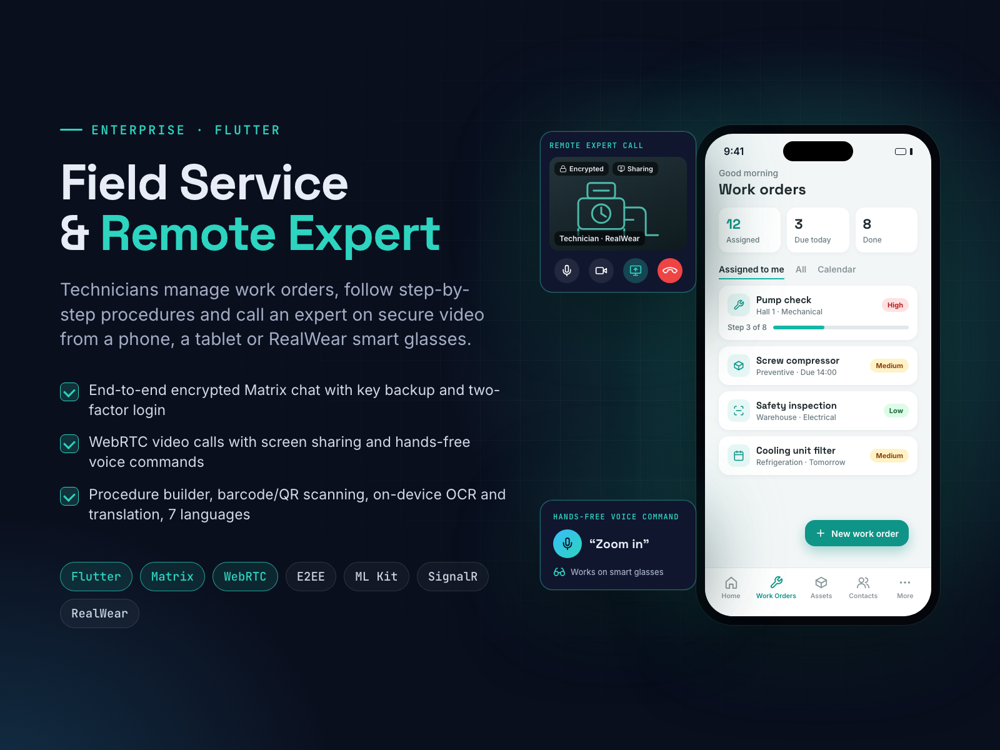

# Field Service & Remote Expert App

**Flutter, Matrix, WebRTC, RealWear**

**Goal:** help field technicians follow procedures and get a remote expert on call, even with their hands busy.

**Solution:** a Flutter app for phones, tablets, web and RealWear smart glasses. Technicians manage work orders, run step-by-step procedures from a procedure builder, scan barcodes/QR codes and use on-device OCR and translation. End-to-end encrypted Matrix chat with key backup, WebRTC video calls with screen sharing and hands-free voice commands. Two-factor login, teams and permissions, 7 languages.

**Result:** secure, hands-free remote support in the field.

| | |
|---|---|
| **My role** | Lead Flutter developer and mobile team lead |
| **Skills** | Flutter, WebRTC, Mobile App Development, Chat & Messaging Software, Android App Development |

## About this repository

This is a showcase repository. It contains the project poster and the poster's own HTML/CSS source in [`poster/`](poster/).
The app was built for a client, so its source code and the client's name are not public.

To re-render the poster, open `poster/index.html` in Chrome at 1600×1200, or run `poster/render.sh` on macOS.

More of my work: **https://ahsanrazapk.github.io**
